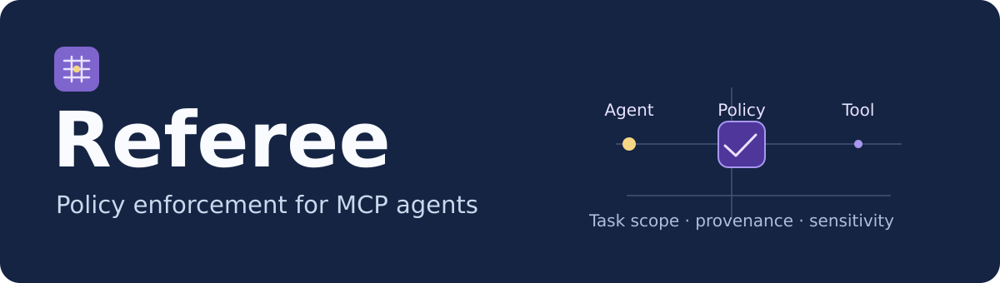

# Referee



[Release landing](https://adventurewave-labs.github.io/referee/) · [Downloads](https://github.com/adventurewave-labs/referee/releases/tag/v0.1.0) · [Policy cookbook](docs/policy-cookbook.md)

**Taint tracking and task-scoped authorization for MCP tool calls.**
Referee is a proxy between an agent and its MCP tools. It labels tool content
that passes through the proxy and checks whether a call is within the task's
capability scope. The configured gate evaluates influence from untrusted
content and the sensitivity of arguments separately. Policy can allow a call,
route it for human approval, or deny it.

The design draws on [CaMeL](https://arxiv.org/abs/2503.18813),
[task-scoped authorization research](https://arxiv.org/abs/2610.05840), and
[Operationalizing CaMeL](https://arxiv.org/abs/2505.22852).

## How it works

```
agent ──MCP──► referee (this proxy) ──MCP──► real tools
                 │
                 ├─ label engine: provenance tags per content block
                 ├─ containment matcher: exact + fuzzy + decoded matching
                 ├─ influence probe: set-based LLM judge (fail-closed)
                 ├─ capability tokens: task-scoped, sensitivity-bearing, TTL + task-end
                 ├─ two-axis gate: capability → integrity → confidentiality → clean-auto-approve
                 ├─ receipts: hash-chained JSONL, HMAC'd args, signed batch heads
                 └─ challenges: redacted Slack buttons / local approver, timeout = deny
```

CI checks a 5 ms budget for the deterministic containment path. For an
integrity-gated call that needs an influence probe, Referee waits for the
configured judge before returning a decision.

## Quick start

Download the archive for your machine and [SHA256SUMS](https://github.com/adventurewave-labs/referee/releases/download/v0.1.0/SHA256SUMS)
into the same directory.

| Platform | Download |
|---|---|
| Linux x86-64 | [referee-v0.1.0-linux-amd64.tar.gz](https://github.com/adventurewave-labs/referee/releases/download/v0.1.0/referee-v0.1.0-linux-amd64.tar.gz) |
| macOS Apple Silicon | [referee-v0.1.0-darwin-arm64.tar.gz](https://github.com/adventurewave-labs/referee/releases/download/v0.1.0/referee-v0.1.0-darwin-arm64.tar.gz) |

### Linux x86-64

```bash
checksum=$(grep -F '  referee-v0.1.0-linux-amd64.tar.gz' SHA256SUMS) &&
printf '%s\n' "$checksum" | sha256sum -c - &&
tar -xzf referee-v0.1.0-linux-amd64.tar.gz &&
cd referee-v0.1.0 &&
./referee policy check --policy examples/policy-coding-agent.yaml
```

### macOS Apple Silicon

```bash
checksum=$(grep -F '  referee-v0.1.0-darwin-arm64.tar.gz' SHA256SUMS) &&
printf '%s\n' "$checksum" | LC_ALL=C shasum -a 256 -c - &&
LC_ALL=C tar -xzf referee-v0.1.0-darwin-arm64.tar.gz &&
cd referee-v0.1.0 &&
./referee policy check --policy examples/policy-coding-agent.yaml
```

The policy check runs locally without starting an MCP server. See
[framework presets](docs/frameworks.md) to connect your client and configure an
upstream server.

### Build from source

Use Go 1.22 or later from the repository checkout.

```bash
go build -o referee ./cmd/referee
./referee policy check --policy examples/policy-coding-agent.yaml
```

Run the bundled demo locally with `./referee demo`.

## Verify receipts

Use a trusted copy of the public key from your deployment to verify signed
batch heads. Save that copy as `trusted-referee-pubkey.hex` for this example.

```bash
./referee verify --log referee-receipts.jsonl --heads referee-heads.jsonl \
  --pubkey trusted-referee-pubkey.hex
./referee why --log referee-receipts.jsonl --decision deny --task deploy-preview-42
```

Receipts record the decision and applicable rule. Argument evidence is stored
as keyed HMACs. See the [threat model](docs/threat-model.md) for the trust
assumptions behind the receipt chain.

## Package map

| Package | PRD section | What it does |
|---|---|---|
| `internal/labels` | §5.1 | tag schema, source registry + path policy, decoding normalizations, containment matcher, rule-based classifier |
| `internal/policy` | §5.2/§5.3 | YAML DSL, compiler, dry-run diff, manifest narrowing |
| `internal/caps` | §5.2 | sensitivity-bearing task tokens; TTL + immediate task-end revocation |
| `internal/probe` | §5.1 | set-based influence probe; cache `(set-hash, arg-hash, sink-class)`; fail-closed; consensus |
| `internal/gate` | §5.3 | the normative two-axis decision algorithm |
| `internal/receipts` | §5.4 | hash-chained log, args HMAC, ed25519 batch heads, verify |
| `internal/challenge` | §5.4/§9 | redacted challenges, allowlist + single-use approvers, Slack signatures, timeout-default-deny |
| `internal/proxy` | §7 | MCP middleware (stdio + streamable-HTTP JSON mode), per-session shadow context |
| `internal/dashboard` | §6 | in-binary operator surface (sessions, decisions, verify, local approver) |
| `internal/tuning` | §6 P1 / §8 | paired-replay probe tuning: corpus loader, full-gate replay, recall/false-challenge metrics |
| `internal/siem` | §6 P1 | OTLP/HTTP receipt export: severity-mapped log records, best-effort tailer (log on disk stays source of truth) |
| `cmd/referee` | — | CLI: serve / verify / why / policy / demo / approve |

## Status

v0.1 — P0 scope complete, plus P1: probe-tuning loop (`referee tune`),
redaction path (`redact: strip|mask`), SIEM export (`referee export` /
`serve --siem-endpoint`, OTLP/HTTP), framework presets
([docs/frameworks.md](docs/frameworks.md)). Known limitations are documented honestly in
[docs/threat-model.md](docs/threat-model.md) (§11 residual risks: transformed
secrets that defeat all normalizations, classifier misses, missing task-end
signals bounded by TTL).

**Not shipped yet:** SSE streaming upstream (JSON mode only), idle-heuristic
task-end (experimental opt-in per PRD; explicit-only v1 shipped), encrypted
evidence escrow (off by default per PRD), and Observe mode.

## Security posture

Referee enforces policy for calls routed through its MCP proxy. Protect the
proxy process, its policy, and its signing keys as part of the trust boundary.
Supply credentials through the documented environment variables. The
[threat model](docs/threat-model.md) covers bypass paths and remaining limits.

## Development

```bash
bash scripts/ci.sh   # vet + build + test + bench (bootstraps Go on remote boxes)
make fuzz            # decoder fuzzing
make demo            # end-to-end scenario
go run ./cmd/referee tune --corpus examples/probe-corpus.yaml --policy examples/policy-coding-agent.yaml --mock
                     # paired-replay probe tuning against the §8 bars (docs/probe-tuning.md)
```

CI asserts the §8 regression suite (per-normalization secret encodings,
double-injection set-probe) and the containment-path latency budget.

Licensed under the [MIT License](LICENSE).
